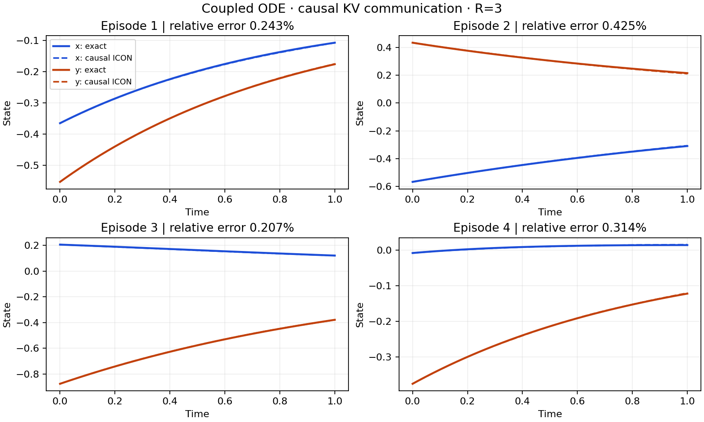

# ICON communication for coupled ODEs

用两个独立的 **causal-mask Transformer** 学习局部解算子，再通过同步 K/V 通信预测耦合 ODE：

$$
\dot x=-ax+\kappa y,\qquad \dot y=-by+\lambda x,\qquad t\in[0,1].
$$

这是从已有 coupled ODE 实验整理出的独立 PyTorch 项目，采用 **ICON-inspired context–query Transformer**。代码包含数据生成、数值参考解、因果注意力、联合训练、评估、测试和一份已训练权重，无需访问原实验目录。

## 快速运行

需要 Python 3.10+。在仓库根目录执行：

```bash
python -m venv .venv
source .venv/bin/activate
python -m pip install -e '.[dev]'

# 使用随仓库提供的权重，在 CPU 上预测四个独立样例并画图
python -m causal_kv.demo

# 运行测试
python -m pytest -q
```

预测图保存在 `outputs/demo/trajectories.png`，轨迹数组和误差分别保存在同目录的 `trajectories.npz`、`metrics.json`。



## 模型怎样通信

每个模型只接收自己的 demonstrations 和查询初值。局部 demonstrations 来自
`dz/dt = -decay*z + coupling*u(t)`，包含已观测的 forcing–response 对；同一组 demonstrations 共享局部系数。隐藏系数不作为模型输入。

1. **Private context encoder**：每个 demonstration 独立编码，token 为 `[initial, forcing, response, time]`。完整 demonstrations 已知，因此该编码器使用双向注意力。
2. **Causal query decoder**：查询 token 为 `[own initial, zero forcing, time]`。每一层 query self-attention 使用时间因果掩码，同时读取自己的完整 context memory。
3. **Synchronous K/V communication**：两边从上一轮 query hidden states 分别投影 Q/K/V，然后同时更新。远端 K/V 与本地 K/V 在 token 维拼接，每个块分别应用相同的物理时间掩码。
4. **Output head**：`prediction(t) = initial + t * head(hidden(t))`，精确满足初值。

对于时刻 `t_i`，本地和远端均只允许读取 `t_j <= t_i` 的 query K/V：

```text
                         local keys       remote keys
query at t_i             j <= i           j <= i
attention mask           [ M              M ]
```

这里使用两个横向拼接的 `N × N` mask。两个 K/V 块都对应相同时间网格；不能把远端块当作接在本地之后的新时间段。完整 demonstrations 的读取不受这个 query 因果掩码限制。

两个模型的参数互相独立。每个模型自己的通信模块在各轮之间共享参数。K/V 不 detach，联合损失通过双方和所有通信轮反向传播。物理预测轨迹不反馈到通信模块；真实查询解只用于训练损失和评估。

默认结构：64 个时间点、4 个 demonstrations、hidden dimension 64、4 heads、2 层 context encoder、2 层 query decoder、每个模型 1 个循环通信模块，共 **403,084 参数**。本实现使用 causal KV concatenation；保留 masked / zero / shuffled K/V 作为评估控制。

## 训练

先用小配置验证整个流程；此配置只用于检查程序能运行：

```bash
python -m causal_kv.training --config configs/smoke.yaml --device cpu --output outputs/smoke
python -m causal_kv.evaluation \
  --checkpoint outputs/smoke/runs/concat_r3/checkpoints/selected.pt \
  --episodes 8 --rounds 0 1 3 --device cpu --output outputs/smoke_eval
```

完整配置从随机初始化联合训练 50,000 步，默认训练通信深度 `R=3`：

```bash
python -m causal_kv.training --config configs/default.yaml --device cuda --output outputs/train
```

训练使用 `coupled MSE + 0.2 * local-task MSE`。所有参数从第一步开始优化，前 1,000 步为学习率 warm-up，之后 cosine decay。验证集选择最佳 checkpoint，测试集不参与选择。`--rounds 1` 或 `--rounds 5` 可以训练其他通信深度，应使用各自的新输出目录。

暂停在指定训练步数，之后恢复同一计划：

```bash
python -m causal_kv.training --config configs/default.yaml --device cuda \
  --output outputs/train_resume --until 500
python -m causal_kv.training --config configs/default.yaml --device cuda \
  --output outputs/train_resume --resume
```

恢复文件包含两个模型、优化器、随机数状态和历史；恢复时配置和训练深度必须一致。新训练会拒绝覆盖已有运行目录。训练输出在 `outputs/<name>/runs/concat_r3/` 下，包含 `checkpoints/{selected,resume}.pt`、配置、history 和状态记录。

在共享集群上，请在获准的计算节点或调度作业中运行训练。

## 评估已训练模型

```bash
# ID / OOD 各 1,024 个样本，比较不同通信轮数及屏蔽通信
python -m causal_kv.evaluation --device cpu

# 较短的评估
python -m causal_kv.evaluation --episodes 64 --rounds 0 3 10 --device cpu

# 加上全部 K/V controls；shuffled 要求每个 batch 至少两个样本
python -m causal_kv.evaluation --controls real masked zero shuffled --device cuda
```

输出 `summary.json` 和逐样本 `per_episode.csv`。误差是拼接两条轨迹后的相对 L2 范数，JSON/CSV 使用比例值，终端显示百分比。

随仓库提供的 `pretrained/causal_kv_r3.pt` 是原实验验证集选出的第 50,000 步权重，训练深度为 3。SHA-256、来源和配置说明见 [pretrained/metadata.json](pretrained/metadata.json)。原实验中该权重在 ID / OOD 各 1,024 个样本上的平均误差约为 **0.3571% / 9.7181%**。这是已有实验结果，整理代码时没有重新执行完整训练。

**通信轮数更多不保证误差更低。** 原实验 R=10 时 ID / OOD 误差约为 7.1479% / 12.3809%。目前应将它视为固定训练深度下的学习型求解器，不能把因果掩码解释成迭代收敛保证。不同硬件和 PyTorch 版本可能产生浮点差异。

## 数据与参考解

- ID：`a,b ~ U(0.6,1.4)`；`kappa,lambda ~ U(-0.25,0.25)`；初值 `U(-1,1)`。
- OOD：decay 在 `[0.25,0.5]` 或 `[1.5,1.9]`；耦合强度绝对值在 `[0.3,0.55]`，符号随机。
- 训练 episode 在线独立生成。demonstration forcing 混合 Fourier、低频正弦、指数和线性漂移，并除以 `max(1,max(abs(forcing)))`；不使用目标值归一化。
- 局部参考解精确求解分段线性插值 forcing；coupled 参考解使用 float64 矩阵指数。
- 一次生成完整测试 split 后再分 batch，保持原实验采样顺序。改变 `--episodes` 会改变采样出的样本集合。

## 目录和代码入口

```text
causal_kv/
  models.py        # causal query attention、KV packet、同步通信和预测
  local_model.py   # private demonstration encoder 和局部 backbone
  data.py          # 在线 episodes 与 Context
  ode_solvers.py   # 精确局部参考解和 coupled matrix exponential
  training.py      # 联合训练、验证选择、断点恢复
  evaluation.py    # ID/OOD 与通信控制评估
  demo.py          # 加载权重并画预测图
  diagnostics.py   # query/通信因果性检查与局部增益诊断
configs/           # 50k 配置和小规模 smoke 配置
pretrained/        # 一个精选 checkpoint 和来源信息
tests/             # 数值解、因果性、无目标泄漏、梯度、恢复和运行流程
```

最小 Python 推理示例（从仓库根目录运行）：

```python
import torch
from causal_kv.data import EpisodeGenerator
from causal_kv.models import from_checkpoint
from causal_kv.training import setup

setup(device='cpu')
model, saved = from_checkpoint('pretrained/causal_kv_r3.pt')
episode = EpisodeGenerator(123, saved['config']).sample(4)
with torch.no_grad():
    x, y = model(episode['context1'], episode['context2'],
                 episode['x0'], episode['y0'], rounds=3)
# x, y: [batch, time_points, 1]
```

原实验来源为 `causal_kv_icon_50k_20261015`，局部数据与数值解来自 `coupled_icon`。本仓库保留 causal 模型和权重结构，补充独立入口、可安装包、短 batch 的验证加权及输出覆盖保护。原始历史实验的源码散列记录在权重 metadata 中。

## 本次整理验证

2026-10-30，在 Python 3.10.3 / PyTorch 2.1.1 / CPU 单线程环境完成：

- **21 项测试通过**，包括数值解、逐层和逐轮因果性、初值、目标隔离、跨模型梯度及确定性恢复。
- 同环境下与原代码比较 8 个样本，在 R=0/3/10、real/masked 控制下预测逐位一致。
- 完成四步 CLI smoke 训练、预测绘图、安装包构建及仓库外加载。
- 使用附带权重重新评估 ID/OOD 各 1,024 个样本，R=3 平均误差为 **0.3571% / 9.7181%**，复现原报告的四位小数结果。

完整统计和环境版本见 [docs/verification.json](docs/verification.json)。
